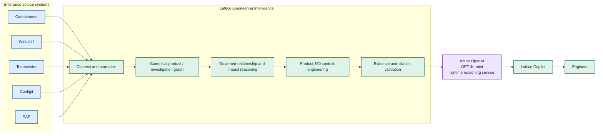
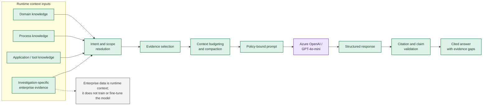
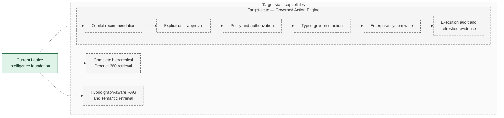

# Lattice AI Architecture

**Purpose:** AI-powered Product 360 and cross-enterprise engineering change-impact investigation
**Audience:** Leadership, business stakeholders, architects, engineers, and technical reviewers
**Architecture view:** Current implementation, intended target, and the delta between them
**Evidence basis:** Repository source, tests, and status documentation reviewed 2026-11-16. A code path is not by itself proof of connected production behavior.

## Executive summary

Lattice is the Engineering Intelligence layer intended to help engineering and
product teams understand a product across requirements, engineering definition,
product configuration, and downstream operational records. Its central use case
is **AI-Powered Product 360 and Cross-Enterprise Change Impact**.

Lattice does not train or fine-tune an LLM on enterprise PLM, ERP, CPQ, or ALM
data. At runtime, it selects governed evidence for an investigation and a
specific question, combines that evidence with domain, process, and application
knowledge, and sends a bounded prompt to Azure OpenAI / GPT-4o-mini. The returned
structured answer is checked against the selected evidence and its citation
allowlist before it is shown and persisted.

The current platform has source integration paths, investigation and
relationship models, Product 360 context construction, a server-side Azure
OpenAI client, answer/citation validation, and Copilot persistence and
diagnostics. Product 360 and relationship reasoning are still being expanded
and hardened. Teamcenter has an implemented connector path, but connected
validation and broader reasoning coverage remain outstanding. The latest
repository-recorded live benchmark is not a release pass.

Today, the Lattice Copilot path is read-only and advisory. This document does
not claim current end-to-end write-back or cross-system action orchestration.
Those are target-state capabilities behind explicit human approval, policy,
authorization, and audit controls.

### At a glance

| Question | Answer |
|---|---|
| What does Lattice do? | Builds a governed engineering view from selected source evidence and answers product/change-impact questions with citations and explicit evidence boundaries. |
| How is the model enabled? | Runtime context engineering: question-relevant domain/process/application knowledge plus investigation evidence, sent to a configured model provider. |
| Is the model trained on enterprise data? | No. Enterprise data is used as bounded runtime context, not as training or fine-tuning data. |
| What is current? | Source-specific integrations, canonical investigation/graph reasoning components, Product 360 and focused views, Azure OpenAI invocation, validation, citations, and local persistence/diagnostics, with maturity varying by capability and source. |
| What is not current? | Production hybrid RAG, complete hierarchical inventory retrieval, a validated multi-system Action Engine path, and a passing live cross-system benchmark. |

## 1. Current architecture

### 1.1 Business problem and architecture purpose

Engineering decisions span systems with different data models and ownership:
requirements describe intent; PLM records define parts and structures; CPQ
systems express variability; ERP contains materials and downstream operational
records. A person investigating a proposed change must identify relevant
records, understand which links are supported by evidence, and see what remains
unknown.

Lattice's purpose is to make that investigation more coherent without replacing
the enterprise applications or treating an LLM as an engineering system of
record. The platform aims to:

- assemble an investigation-specific, provenance-preserving view from source
  data;
- explain relationships only when supported by governed or source evidence;
- expose evidence gaps and source freshness/completeness limits;
- prepare compact, question-specific context for a natural-language model; and
- return a cited explanation that can be inspected and challenged.

**Current scope:** read, understand, reason, cite, and explain. Copilot
recommendations are advisory; the current Lattice path does not execute
enterprise-system writes.

### 1.2 Enterprise systems and ownership

Source applications remain authoritative for their own records. Lattice's
canonical investigation graph is an authority for the assembled investigation,
its provenance, and its supported relationship reasoning; it does not supersede
the source system of record.

| Domain | Current integration | Information owned by the source | Current-state qualification |
|---|---|---|---|
| ALM | **Codebeamer** | Requirements, specifications, requirement hierarchy, trackers, lifecycle, requirement relations, and engineering intent | A backend adapter and catalog/live-enrichment path exist. Catalog evidence and live enrichment can have different freshness and completeness. |
| PLM | **Windchill** | Parts, part occurrences, product structures, engineering documents, CAD/product-definition records where available, lifecycle, revisions, and engineering changes | Python/OData extractor and backend adapter paths exist. Supported object and change coverage depends on the specific extraction operation and connected evidence. |
| PLM | **Teamcenter** | Product/item records, structures, and lifecycle information exposed by the implemented SOA integration | **Current integration, not planned.** Connector/extractor availability is distinct from connected validation, Product 360 inclusion, relationship reasoning coverage, and parity with Windchill. Connected validation is documented as blocked. |
| CPQ / product configuration | **Configit** | Product/work-item subjects, product models and contexts, configuration families, features, rules/expressions, market variability, and localization | Integration and extraction paths exist. The current Steering investigation keeps **Steering, Work-item ID 305** as the primary representative; **Market / MRKT** is a secondary configuration family. |
| ERP | **SAP** | Materials, units of measure, stock, movements, production/procurement context where available, accounting records, and downstream operational context | Java/JCo extraction and specialized operational evidence paths exist. Available records depend on the operation, authorization, and successful live extraction. |
| AI provider | **Azure OpenAI / GPT-4o-mini** | No enterprise system-of-record responsibility | Called from the server with configured deployment/API settings. Provider availability, network approval, and live benchmark success are separate operational gates. |

Repository evidence for the source boundaries includes the
[API and extractor map](API-AND-EXTRACTOR-MAP.md), the
[platform capability inventory](PLATFORM-CAPABILITY-INVENTORY.md), the
[Teamcenter runtime audit](../backend-standardization/TEAMCENTER-RUNTIME-AUDIT.md),
and the [Teamcenter connected-validation record](../backend-standardization/TEAMCENTER-CONNECTED-VALIDATION.md).

### 1.3 Current integration and intelligence flow

1. A user selects or searches for product records and starts an investigation.
2. Source-specific connectors and extractors call the relevant enterprise
   systems or approved local catalogs.
3. Adapter paths normalize source results into standard extraction/discovery
   contracts and retain source identifiers, provenance, source status, and
   available evidence.
4. Lattice builds or consumes an investigation snapshot with entities,
   attributes, source participation, relationships, and evidence.
5. Relationship and ontology logic evaluates candidate edges. Unresolved
   relationships remain unresolved; the system must not invent a link from
   similar names or co-occurrence.
6. Copilot classifies the question, selects relevant context, compacts it to
   configured limits, constructs a policy-bound prompt, and calls the provider.
7. The response is parsed and validated for schema, claims, citations, snapshot
   revision, and evidence boundaries before being persisted and rendered.

The repository contains both a backend unified-intelligence assembly path and a
Lattice Copilot context path. They must not be presented as one fully integrated
production pipeline unless the connecting runtime path is separately proven.
The [platform capability inventory](PLATFORM-CAPABILITY-INVENTORY.md) identifies
direct Lattice consumption of the unified backend result as unavailable in its
audit.

### 1.4 Canonical investigation and relationship intelligence

The investigation model separates subject, entities, relationships, evidence,
findings, source representations, identity clusters, temporal context, and
summary. The backend also has a versioned
[canonical engineering-intelligence contract](CANONICAL-INTELLIGENCE-CONTRACT-V1.md)
and assembly/validation components. In the Lattice Copilot runtime, the
investigation snapshot is enriched with a knowledge graph and ontology-derived
reasoning where the required input evidence is present.

Relationship processing distinguishes:

- **Source-authoritative evidence:** a relationship or reference returned by a
  source system, retaining its source and provenance.
- **Canonical relationship:** a normalized relationship candidate represented
  in the investigation.
- **Ontology-resolved relationship:** a relationship whose required evidence
  satisfies a governed relationship rule.
- **Subject traceability:** evidence that applications participate in the
  same investigation subject; it does not prove that two records are the same
  object or that one affects the other.
- **Unresolved evaluation:** a rule evaluation without sufficient supported
  evidence; it remains an evidence gap, not a relationship.
- **Impact path / chain:** a reasoning path permitted by eligible relationships
  and evidence. It is not inferred solely from co-occurrence.

The
[relationship rules](../relationships.md) define deterministic evidence
requirements. For example, a Windchill-part-to-SAP-material
`operationally-represented-as` link requires governed matching evidence; merely
having a Windchill part and SAP material in the same investigation is not
sufficient.

### 1.5 How runtime context enables the model

The model is enabled at inference time by four context layers:

| Runtime context layer | What Lattice contributes | Example |
|---|---|---|
| **Domain knowledge** | Engineering concepts, record types, attributes, and relationships | Part, material, requirement, product structure, change notice, feature, rule, stock record |
| **Process knowledge** | How engineering work proceeds and what needs review | Requirements definition, product definition, configuration management, lifecycle/release, change control, downstream execution, impact review |
| **Application/tool knowledge** | Ownership and semantics for each connected system | Windchill part vs Teamcenter item; Codebeamer tracker/requirement; Configit family/feature; SAP material/operational records |
| **Investigation-specific enterprise evidence** | Selected records and their attributes, relationships, citations, provenance, freshness, completeness, evaluations, paths, and evidence gaps | The entities and supported relationships selected for the Steering investigation and the current question |

An identically named record in two systems is not automatically the same
enterprise object. Identity requires source-native identifiers or other
explicitly governed evidence. The model receives only the question-relevant
projection that survives selection and context-budget rules; it does not
receive an unrestricted dump of every source record.

For an explicit request for one fact and citation per named application,
ContextCompiler selects one representative fact per requested application,
preferring measures and transaction values over identity-only fields, and
includes the matching source passages and application participation. This
selection is specific to the requested answer shape; it does not alter the
investigation snapshot or remove facts from later queries.

- **Risk prevented:** unrelated field-level records can overwhelm the model
  request and trigger provider token-rate limits, delaying or failing an answer.
- **Why the risk is real:** the observed request contained 2,354 candidates
  (about 888,401 estimated input tokens), spent about 14 seconds compiling
  context, and received Azure OpenAI `429 rate_limit_exceeded`.
- **Why this is necessary:** the user requested one fact per named application;
  sending every field from every record cannot improve that requested answer
  and exceeds the deployment's measured operating limit.
- **User-value tradeoff:** this answer returns one cited fact per requested
  application rather than an exhaustive inventory; the remaining evidence stays
  available for follow-up questions.

#### Runtime model flow

```text
Domain knowledge
        +
Process knowledge
        +
Application/tool knowledge
        +
Investigation-specific enterprise evidence
        |
        v
Intent classification and evidence selection
        |
        v
Governed, bounded context engineering
        |
        v
Policy-bound prompt and structured response contract
        |
        v
Azure OpenAI / GPT-4o-mini (server-side runtime call)
        |
        v
Response parsing, citation allowlisting, claim validation,
and evidence-boundary checks
        |
        v
Cited answer, uncertainty, evidence gaps, and drill-down options
```

In the current implementation, Copilot context construction and the server-side
Azure client are in the frontend application server, not in the model itself.
Server-side configuration requires an explicit live-call enable flag and keeps
the provider key out of client code. See
[context construction](../../frontend/features/lattice-next/copilot/context-builder.ts),
[turn execution](../../frontend/features/lattice-next/copilot/execute-copilot-turn.ts),
[Azure transport](../../frontend/features/lattice-next/copilot/azure-openai-client.ts),
and [provider configuration](../../frontend/features/lattice-next/copilot/config.ts).

### 1.6 Product 360 and focused application views

Product 360 is implemented and being hardened/expanded. Current capabilities
include:

- broad coverage of the participating applications;
- application-specific overview routing;
- semantic representative selection;
- compact, application-specific evidence digests;
- citations, source-state warnings, and evidence boundaries;
- application isolation and context-budget enforcement; and
- available categories for follow-up drill-down.

For Configit, the primary representative remains **Steering, Work-item ID 305**.
**Market / MRKT** remains secondary. Application overviews and Product 360
summaries do not imply that every child object or every hierarchy level has
been retrieved. Complete record-by-record hierarchical inventory retrieval is
not claimed as current.

The Product 360 context projection is intentionally smaller than an entire
enterprise inventory. It prioritizes representatives, selected facts,
relationships where supported, evidence boundaries, citations, and drill-down
availability. The detailed
[Product 360 phase plan](../superpowers/plans/2026-11-12-product-360-phase-2-1.md)
and Copilot context implementation record the context and evidence constraints.
Product 360 must cover every meaningful upstream application and relevant
category for the investigation; when a source or category is unavailable,
unsupported, or unvalidated, that boundary must be stated rather than implying
complete coverage.

### 1.7 M1, E1, and M2 reasoning paths

| Case | Intended reasoning | Current implementation status | Validation boundary |
|---|---|---|---|
| **M1 — application connectivity** | Identify participating applications and explain only supported cross-application relationships. | Application participation and relationship context are represented in Copilot reasoning. | The latest recorded live investigation has no ontology-resolved cross-system relationships; presence of multiple applications alone cannot satisfy a connectivity claim. |
| **E1 — primary entities** | Prioritize meaningful business entities over metadata and represent application diversity. | Entity ranking/selection logic and offline regression coverage exist. | The latest recorded live answer did not meet the expected cross-application business-entity coverage. |
| **M2 — operational consequence** | State a consequence only when the required Windchill-to-SAP relationship and eligible impact evidence exist; otherwise state insufficiency. | Consequence-evidence state and evidence-constrained validation paths exist. | The latest recorded live graph lacks the necessary Windchill-to-SAP relationship and impact path; the expected consequence cannot be asserted. |

The last detailed
[Sprint 1A live validation](../../frontend/features/lattice-next/copilot/benchmark-live-validation.md)
records the live release gate as failed or mismatched. It reports 209 canonical
relationships but zero ontology-resolved relationships and zero impact paths
in the investigated live snapshot. Offline tests and fixture-backed reasoning
demonstrate code-path behavior; they do not turn that live result into a pass.
Use current benchmark reports when revising this status.

### 1.8 Current Action Engine boundary

The current Lattice Copilot path is **read-only and advisory**. Recommendations
are not executed, and the repository does not establish a production-ready,
integrated Action Engine or end-to-end multi-system write path for this Copilot
use case. This boundary applies to the integrated Copilot path; standalone
Action Engine prototypes and controlled Windchill write experiments exist
separately, but do not establish integrated, production-ready multi-system
write capability. Do not present those separate efforts as current Copilot
capability.

### 1.9 Executive architecture

**Notation:** blue = enterprise source systems; green = current Lattice
capabilities; purple = external runtime AI service; amber = hardening or
validation pending.



The five source systems remain authoritative for their own records. Lattice
normalizes selected evidence into a canonical investigation representation;
that representation does not replace the source records. Azure OpenAI is an
external runtime reasoning service, not part of the Lattice boundary. This
executive current-state view intentionally omits RAG and Action Engine.

### 1.10 Current technical architecture

**Notation:** blue = source-authoritative data; green = current Lattice
capabilities; purple = Azure OpenAI; amber = hardening or validation pending.
The five groups below are the current path, organized into five layers.

```mermaid
flowchart LR
  subgraph L1["1. Enterprise sources"]
    sources["Codebeamer · Windchill · Teamcenter · Configit · SAP<br/>authoritative records"]:::source
  end

  subgraph L2["2. Connectors and extraction"]
    extract["Source connectors and extractors<br/>Teamcenter: current path; broader validation pending"]:::pending
  end

  subgraph L3["3. Canonical intelligence and governed relationships"]
    canonical["Lattice canonical investigation<br/>entities, evidence, source references"]:::current
    relationships["Governed relationships<br/>ontology and impact reasoning"]:::current
  end

  subgraph L4["4. Context engineering and Azure OpenAI"]
    context["Product 360 and question-scoped context"]:::current
    azure["Azure OpenAI / GPT-4o-mini"]:::ai
  end

  subgraph L5["5. Validation, Copilot, persistence, diagnostics"]
    answer["Citation and claim validation<br/>Lattice Copilot answer"]:::current
    operations["Conversation persistence<br/>turn diagnostics and usage ledger"]:::pending
  end

  sources --> extract --> canonical --> relationships --> context --> azure
  azure --> answer --> operations

  classDef source fill:#dceeff,stroke:#286090,stroke-width:1.5px,color:#17324d
  classDef current fill:#dff3e8,stroke:#27734a,stroke-width:1.5px,color:#173b28
  classDef ai fill:#eee5ff,stroke:#7040a0,stroke-width:1.5px,color:#321d4d
  classDef pending fill:#fff2cc,stroke:#b77900,stroke-width:1.5px,color:#493500
```



Source records remain authoritative; the canonical investigation graph is
Lattice's evidence-linked representation for reasoning. Connector coverage,
freshness, and connected validation vary by application. Teamcenter has a
current connector path, but broader connected validation remains pending.
This current-state diagram excludes production RAG, complete hierarchical
inventory retrieval, and governed actions.

### 1.11 Runtime context-engineering flow



The four inputs are assembled at runtime for the active question. Enterprise
evidence is passed as bounded context; it is not used to train or fine-tune the
model. Citation and claim validation constrain the final answer to supported
evidence and make evidence gaps explicit.

### 1.12 Target-state evolution



All three branches are target-state capabilities. The Action Engine sequence
requires explicit approval and policy/authorization before a typed action can
write to an enterprise system; execution must be audited and resulting
evidence refreshed. It is not a current integrated Copilot write path. RAG
remains fixture-backed, with production use on hold; complete hierarchical
retrieval is also not established as current capability.

#### Relationship and impact boundary

- Shared subject participation establishes that source applications contributed
  records to an investigation; it does **not** establish object identity,
  dependency, impact, or causation.
- Exact identifiers, governed mappings, and source-native references are
  evaluated according to their relationship rule. Similar names and lexical
  similarity may help select candidates but cannot prove a relationship.
- Impact conclusions require eligible governed or ontology-resolved evidence
  and an allowed impact path. If that evidence is absent, the correct answer is
  that impact is not established by the current investigation.

### 1.13 Trust, governance, and evidence controls

| Control | Current behavior or boundary |
|---|---|
| Source authority | Enterprise applications remain systems of record. Lattice preserves source provenance and does not make the LLM authoritative. |
| Identity and relationships | Candidate identity and relationships require explicit evidence and governed rules. Unresolved evaluations stay unresolved. |
| Citations | Factual claims are checked against an allowlist derived from the active context. Unknown citations are rejected. |
| Evidence boundaries | Unsupported consequence claims are rejected; an insufficient-evidence conclusion is allowed. |
| Freshness and completeness | Source state and warnings are surfaced where available; missing warning is not proof of freshness or completeness. |
| Prompt scope | Intent classification and evidence selection limit context to the requested investigation/question; focused application views preserve application isolation. |
| Context size | Context is budgeted and compacted rather than sending all records. Required evidence and citations are protected before optional detail is trimmed. |
| Untrusted source text | Retrieved/source text is treated as evidence, not as instructions to the model. |
| Repair | Bounded response repair can correct response shape or validation issues; it cannot establish new source evidence. |
| Conversation and diagnostics | Conversation turns, stage outcomes, and usage metadata are persisted/recorded. Current file-backed stores are local/single-instance and are not a completed multi-user production boundary. |
| Authentication and authorization | Release documentation identifies authentication, per-investigation authorization, and shared durable storage as gates before public/shared multi-user deployment. |
| Model feedback | Validation and benchmark feedback can inform evaluation and engineering work; it does not retrain the deployed model. |
| Enterprise actions | Current Copilot is advisory. Future writes require explicit approval, policy and authorization enforcement, source permissions, validation, and execution audit. |

See [Copilot release gates](../../frontend/features/lattice-next/copilot/RELEASE-GATES.md)
for the documented privacy, provider, persistence, authentication, and release
boundaries.

### 1.14 Current-state limitations

- Source integrations do not imply that every object type, relationship, or
  operational record is available in every investigation.
- Teamcenter has a current connector/extractor path, but its connected
  validation is blocked in the latest validation record; broader Product 360
  and relationship reasoning coverage remains to be demonstrated.
- The backend canonical intelligence assembler and the Lattice Copilot
  investigation path exist as components; their end-to-end production
  integration must not be assumed from contract existence alone.
- The latest recorded live benchmark does not pass all expected cases. In
  particular, the live investigation used for Sprint 1A lacked resolved
  cross-system relationships and eligible impact paths.
- Product 360 is a coverage summary with selected evidence and drill-down
  categories, not a promise that all child objects are in the Copilot prompt or
  answer.
- Production semantic retrieval and RAG are not active. The repository
  describes a fixture-backed foundation and identifies production access,
  identity, ACL, storage, and source-content requirements that remain open.
- Current Lattice Copilot actions are read-only/advisory. No integrated
  production-ready multi-system write path is claimed.

## 2. Target architecture

### 2.1 Target-state intent

The target architecture extends the current evidence-grounded investigation
without weakening source authority or evidence controls. It should provide
complete category coverage and retrieve detailed inventories on demand, while
keeping the answer context bounded. It should expand validated relationship and
impact coverage and, only when separately governed, support approval-gated
actions.

### 2.2 Target capabilities

1. **Complete hierarchical drill-down:** retrieve object inventories by
   category, filters, source, revision, or graph traversal rather than placing
   every record in a single prompt.
2. **Broader Teamcenter participation:** expand Product 360 and relationship
   reasoning where connected extraction and evidence support it; establish
   validation before claiming parity with Windchill or other sources.
3. **Expanded cross-system relationship mappings:** add only relationships
   whose endpoints, evidence rules, provenance, and validation are governed.
4. **Structured and semantic retrieval:** combine structured filtering,
   graph traversal, and semantic retrieval over authorized long-form evidence.
5. **Hybrid graph-aware RAG:** retain the canonical graph as relationship and
   identity authority; use retrieved documents only as separately authorized,
   cited supporting evidence. Production RAG remains on hold until identity,
   ACL, retention, storage, and deployment requirements are resolved.
6. **Section-level summarization:** summarize large evidence sections on
   demand, keep citations and source status at section/object level, and avoid
   losing important facts during context compaction.
7. **Broader impact and predictive reasoning:** distinguish verified paths,
   plausible hypotheses, and evidence gaps; predictive conclusions require
   calibrated evaluation and governance before use.
8. **Governed enterprise actions:** permit proposed changes only through an
   explicit review/approval and policy boundary, with least-privilege
   authorization and a traceable execution result.
9. **Scalable operations:** improve durable shared persistence, multi-user
   access control, benchmark coverage, and resilience as deployment needs are
   confirmed.

### 2.3 Target governed-action flow

```text
Lattice Copilot recommendation
        |
        v
Explicit user approval
        |
        v
Policy and authorization boundary
        |
        v
Governed Action Engine
        |
        v
Enterprise-system write
        |
        v
Execution audit and result returned to the investigation
```

The action engine is not the current Lattice Copilot architecture. The target
must validate the proposed fields, target application, user authority, source
permissions, idempotency, audit, failure handling, and any supported rollback
or compensation before enabling writes. No source-system write occurs solely
because the LLM recommended it.

### 2.4 Target-state principles

- Retrieve full inventories through authorized, source-aware drill-down rather
  than inflating the initial prompt.
- Keep graph identity/relationship authority distinct from retrieved document
  text and model-generated language.
- Preserve object-level citations, revisions, freshness, and access decisions
  through retrieval and summarization.
- Fail closed when principal, source permission, or evidence status cannot be
  established.
- Gate each action independently; read access does not imply write permission.
- Keep human approval, policy enforcement, execution, and audit as explicit
  architecture boundaries.

## 3. Delta between current and target

### 3.1 Capability delta

| Capability | Current state | Target state | Delta / work required | Status |
|---|---|---|---|---|
| Source integrations | Windchill, Teamcenter, Codebeamer, Configit, and SAP have connector/extractor paths; live depth and validation differ by source. | Reliable, observable, versioned extraction coverage across required object categories. | Validate each source, object type, permissions, freshness, completeness, and failure behavior independently. | Implemented, partial coverage |
| Teamcenter coverage | Current SOA/legacy pipeline and adapter expose product/item and structure extraction; connected validation is blocked. | Broader Product 360 and relationship reasoning participation where evidence supports it. | Complete approved connected validation; expand and benchmark supported object paths; do not assume Windchill parity. | Requires benchmark validation |
| Codebeamer coverage | Backend adapter and catalog/live-enrichment path exist; current cached catalog and live enrichment can differ. | Consistent provenance-preserving inclusion in the canonical cross-enterprise investigation. | Verify federated participation and typed canonical mapping coverage across the full path. | Implemented, partial coverage |
| Canonical model | Versioned standard extraction and canonical investigation contracts/assemblers exist. | One dependable end-to-end canonical contract consumed by Lattice with stable identity and evidence semantics. | Validate the production seam from federated extraction through backend assembly to Lattice snapshot. | Implemented, hardening |
| Authoritative graph | Lattice/PLM Brain models investigation entities and relationships; source systems remain authoritative for their records. | Maintain a complete, validated canonical graph as the stable reasoning foundation. | Continue testing graph materialization, revision behavior, and source-specific evidence; do not equate graph presence with source completeness. | Implemented, hardening |
| Provenance and source state | Source IDs, provenance, and source status are represented in current contracts and context. | Consistent freshness/completeness semantics for every displayed object and relationship. | Expand connected-state validation and make absent/stale/partial evidence consistently visible. | Implemented, partial coverage |
| Product 360 | Broad multi-application summaries, focused overviews, evidence digests, citations, warnings, and drill-down categories exist. | Complete category coverage plus on-demand hierarchical object inventory. | Expand supported categories and retrieval depth without copying full inventories into one prompt. | Implemented, hardening |
| Focused application views | Application-specific routing, isolation, representatives, and evidence summaries exist. | Consistent source-specific drill-down across all supported categories and revisions. | Extend validated evidence coverage and preserve isolation as retrieval expands. | Implemented, hardening |
| Representative selection | Semantic/application-aware representative policies exist; Configit Steering / Work-item ID 305 remains primary and Market / MRKT secondary. | Stable, evidence-driven representatives with quality measured across sources and investigations. | Continue application-specific benchmark validation; do not allow extraction order or record count to override policy. | Implemented, regression-tested, and undergoing live validation |
| Relationship intelligence | Subject traceability, canonical relationships, ontology rules, and resolved/unresolved evaluation paths exist. | Broader validated cross-system mappings with sufficient source evidence. | Materialize missing evidence and validate mappings. A shared subject or matching name is insufficient. | Blocked by evidence or mapping |
| Impact reasoning | Impact-path/chain generation and consequence-evidence controls exist; fixture evidence demonstrates the reasoning path. | Reliable live cross-system impact reasoning with measurable coverage and calibrated uncertainty. | Populate and validate eligible relationships in live investigations; benchmark exact paths and consequence claims. | Requires benchmark validation |
| Context budgeting | Context construction applies selection, compaction, and maximum-size checks. | Scalable evidence selection with predictable latency/cost and preserved citation coverage. | Benchmark larger, more varied investigations and retain protected evidence under pressure. | Implemented and validated |
| Hierarchical drill-down | Summaries expose selected facts and available drill-down categories; complete inventory retrieval is not established. | Filtered object-level traversal and complete category inventory on demand. | Implement source/category query APIs, paging, revision-aware traversal, and citation-preserving results. | Planned |
| Graph-aware retrieval | Current graph/ontology traversal informs relationship and impact reasoning. | Hybrid retrieval combining governed graph traversal with structured and semantic evidence search. | Integrate a production retrieval path without allowing similarity to create graph relationships. | Implemented, hardening |
| Semantic retrieval | Fixture-backed retrieval foundations exist; production semantic search is not enabled. | Authorized semantic retrieval over approved long-form engineering evidence. | Resolve identity, ACL, content ownership, index/storage, retention, cost, and evaluation prerequisites. | Planned |
| RAG | RAG is fixture-backed only; production use is explicitly on hold. | Hybrid graph-aware RAG that supplies separately authorized and cited supporting documents. | Complete production blockers in the RAG boundary documentation and pass retrieval/citation benchmarks before activation. | Planned |
| Action workflows | The integrated Copilot path is read-only and advisory. Standalone Action Engine prototypes and controlled Windchill write experiments exist separately; no integrated production-ready multi-system write path is confirmed. | Approval-gated actions with policy, authorization, write execution, result capture, and audit. | Establish the integrated Action Engine contract, application-specific permissions, validation, idempotency, failure handling, and supported compensation. | Planned |
| Diagnostics and persistence | Turn-stage diagnostics and usage ledger exist; file-backed stores are local/single-instance. | Durable, shared, access-controlled persistence and complete operational monitoring. | Define deployment topology, shared storage, concurrency, retention, backup, access, and audit requirements. | Implemented, hardening |
| Governance | Citation allowlisting, evidence boundaries, source-state caveats, and safe provider configuration exist. | End-to-end identity, per-investigation authorization, retrieval ACLs, and action policy across shared deployment. | Close authentication, authorization, shared-storage, data-residency, and policy-versioning gates. | Implemented, partial coverage |
| Benchmarking and validation | Offline suites and synthetic fixtures validate selected contracts; the latest recorded live Sprint 1A benchmark is not a pass. | Repeatable source-connected benchmarks with provider-backed answers and release thresholds. | Correct investigation-data alignment, establish approved provider connectivity, and execute live M1/E1/M2 and source-coverage gates. | Requires benchmark validation |
| Predictive reasoning | Evidence-backed reasoning and hypotheses are bounded; production predictive capability is not established. | Evaluated predictive engineering insight with confidence, evidence, and human oversight. | Define validated use cases, labeled evaluation data, calibration, governance, and release thresholds. | Planned |
| Multi-system action audit | Current Copilot does not write to enterprise systems. | Auditable action proposal, approval, execution, and resulting source evidence. | Implement integrated action records, source response capture, immutable audit links, and review/compensation flow. | Planned |

### 3.2 Business use case

#### AI-Powered Product 360 and Cross-Enterprise Change Impact

A product or engineering team is considering a design change to the Steering
component and must understand what should be reviewed across ALM, PLM, CPQ, and
ERP before approving the change.

```text
Proposed Steering design change
        |
        +--> Codebeamer requirements and engineering-intent review
        |
        +--> Windchill engineering-definition and change-context review
        |
        +--> Teamcenter product/structure records available in this investigation
        |
        +--> Configit CPQ configuration-family, feature, and rule review
        |
        +--> SAP material and operational-record review
        |
        v
Governed relationship analysis
        |
        +--> Verified relationships and eligible impact paths
        |
        +--> Unresolved mappings and unsupported inferences
        |
        v
Evidence-backed impact conclusion or explicit evidence gap
```

The diagram represents review areas, not a claim that every system currently
contains a linked Steering record. Windchill and Teamcenter records must not be
assumed to be the same object. Each cross-system identity or impact assertion
requires evidence and a supported relationship rule.

### 3.3 Hero demo question

> We are considering a design change to the Steering component. Build a
> complete Product 360 view across Codebeamer, Windchill, Teamcenter, Configit,
> and SAP. Identify the requirements, engineering records, product-configuration
> rules, and operational material information that should be reviewed, and
> clearly separate verified relationships and impacts from unresolved or
> missing evidence.

**Expected answer organization:**

1. Change under investigation
2. Requirements and engineering intent
3. Windchill product definition
4. Teamcenter product data available in the current investigation
5. Configit CPQ and configuration implications
6. SAP operational and material context
7. Verified governed relationships
8. Unresolved mappings
9. Supported impact paths
10. Evidence gaps
11. Recommended next investigation steps

The word **complete** in this demo question means complete coverage of the
listed categories within the available and authorized investigation evidence.
It does not promise that all enterprise records are already loaded or linked.
The answer must label missing source data, incomplete extraction, unresolved
identity, or absent impact evidence rather than filling gaps with model
inference.

### 3.4 End-to-end question and answer flow

1. **Start from an investigation:** load or select a snapshot with source
   records, source state, provenance, and supported relationships.
2. **Receive a question:** bind the request to the active investigation and
   snapshot revision.
3. **Classify intent:** distinguish Product 360, focused application overview,
   relationship, impact/consequence, entity, and document questions.
4. **Resolve scope:** select entities and application participation relevant
   to the question; ask for clarification when entity resolution is ambiguous.
5. **Select evidence:** prioritize supported source records, governed
   relationships, source freshness/completeness, and allowed reasoning paths.
6. **Build context:** combine domain/process/application semantics with the
   selected investigation-specific evidence; compact to the configured budget.
7. **Call the model:** send a policy-bound server-side request to Azure OpenAI
   with the structured response contract.
8. **Validate the answer:** parse the response, validate schema and revision,
   allowlist citations, check factual claims and evidence boundaries, and use
   bounded repair or safe failure where required.
9. **Persist and render:** store the validated turn, diagnostics, and usage
   metadata; render citations and evidence boundaries in Lattice Copilot.
10. **Offer follow-up:** present available drill-down categories or
    investigation steps. No source refresh or write occurs unless a separate
    authorized workflow explicitly initiates it.

### 3.5 Action Engine architecture

#### Current

- Current Lattice Copilot recommendations are advisory.
- The current Lattice Copilot path is read-only with respect to Windchill, SAP,
  Configit, Teamcenter, and Codebeamer.
- Standalone Action Engine prototypes and controlled Windchill write
  experiments exist separately; they are not an integrated Copilot write path.
- The repository does not confirm an integrated, production-ready Action Engine
  for this multi-system use case.
- No current end-to-end write-back or cross-system action orchestration is
  claimed.

#### Target

```text
Recommendation
    -> user reviews proposed fields and target application
    -> explicit approval by an authorized user
    -> policy and authorization evaluation
    -> governed, application-specific Action Engine
    -> source-system validation and write
    -> execution result and audit record
    -> refreshed evidence linked to the investigation
```

Each write action must be an explicit, typed operation rather than free-form
model text. It must validate the target object and fields, preserve the
approver/action identity, enforce least privilege, prevent unintended duplicate
execution, capture source-system responses, and report partial/failure states.
Rollback or compensation is required only where the target application and
operation support it; the architecture must not promise universal rollback.

### 3.6 Planned capabilities and roadmap

The sequence below is a capability dependency view, not a committed delivery
schedule:

1. **Stabilize current evidence path:** improve source-state completeness,
   investigation alignment, Teamcenter connected validation, and repeatable
   M1/E1/M2 live benchmarks.
2. **Complete Product 360 retrieval:** add source/category filters, paging,
   hierarchy traversal, and object-level citations; keep broad summaries
   bounded.
3. **Expand relationship coverage:** add validated mappings only when their
   source evidence and object semantics are established.
4. **Unblock production retrieval:** resolve identity, authorization, ACL,
   content ownership, storage, retention, deployment, and evaluation gates
   before production hybrid RAG.
5. **Scale reasoning:** introduce section-level summarization and broader
   impact/predictive reasoning only with calibrated evidence and benchmarks.
6. **Design governed actions:** define the Action Engine integration, policy,
   approval, audit, and source-specific validation boundaries before any
   multi-system write enablement.
7. **Harden operational foundations:** implement shared durable storage,
   multi-user authorization, resilience, and production monitoring appropriate
   to the selected deployment.

RAG work is on hold while Product 360 pre-context and evidence behavior are
stabilized. Predictive reasoning and multi-system action workflows remain
target-state items until their data and governance prerequisites are proven.

### 3.7 Assumptions

- Windchill, Teamcenter, Codebeamer, Configit, and SAP are in the requested
  current integration scope, but do not have identical connector maturity or
  evidence coverage.
- Teamcenter's adapter/extractor implementation is current. The breadth of
  connected behavior, current Product 360 inclusion, and reasoning parity
  require separate validation.
- Azure OpenAI / GPT-4o-mini is the current configured model-provider target;
  configuration availability does not imply that a live provider request
  succeeded or passed a benchmark.
- The Lattice investigation graph is the canonical reasoning representation
  for the active investigation; enterprise applications remain authoritative
  for their own source records.
- Target-state features are architectural intent, not delivery commitments or
  proof of current functionality.

### 3.8 Known limitations and open decisions

- Exact connected environments, network paths, resource sizing, deployment
  topology, and production service-level objectives are outside the evidence
  established by this architecture review.
- Per-user authentication, per-investigation authorization, shared durable
  storage, and production RAG ACL semantics are identified release/design gates.
- Connected source freshness, full object-category coverage, and supported
  revisions vary by system and operation.
- The latest recorded live benchmark does not establish passing M1/E1/M2
  answers for the live investigation; the fixture and live-investigation results
  must remain distinct.
- The precise integrated contract between backend unified intelligence and the
  Lattice snapshot/Copilot pipeline must be validated before claiming one
  end-to-end production data path.
- Action Engine integration, approval identity, policy ownership, source
  write permissions, audit retention, retries, and compensation need explicit
  design before implementation.
- Storage, inference/token budgets, and source-system write permissions remain
  subject to IT, security, application-owner, and finance approval.

### 3.9 Architecture principles

1. **Source-authoritative evidence:** source systems own their records; Lattice
   records provenance and source state.
2. **Runtime context engineering, not retraining:** enterprise data is selected
   for a request and supplied as bounded context; it does not train the LLM.
3. **Evidence-first reasoning:** claims and consequences must be supported by
   allowed evidence and citations.
4. **Canonical but provenance-preserving representation:** normalize records
   for cross-system reasoning without erasing source identity or authority.
5. **Participation is not identity:** shared subject participation does not
   prove records are identical or related.
6. **Impact requires governed evidence:** impact paths/chains need eligible,
   evaluated relationships and cannot be inferred from co-occurrence.
7. **Bounded context:** select and compact question-relevant evidence instead
   of placing every record in one prompt.
8. **Coverage plus drill-down:** provide category coverage, selected facts, and
   routes to detail without claiming every inventory item is in the summary.
9. **Cite factual claims:** validate citations against the active investigation
   and reject unknown references.
10. **Make uncertainty explicit:** preserve stale/partial status, unresolved
    mappings, unsupported conclusions, and evidence gaps.
11. **Separate maturity states:** distinguish implemented, hardening, partial,
    blocked, and planned capabilities throughout diagrams and tables.
12. **Approval-gated actions:** future enterprise writes require explicit
    approval, authorization, policy controls, and audit.
13. **No invented parity:** do not assume Teamcenter/Windchill parity or
    cross-system object identity without validated evidence.

### 3.10 Glossary

| Term | Meaning in this architecture |
|---|---|
| **PLM** | Product Lifecycle Management: engineering product definition, parts, structures, changes, and lifecycle records. |
| **ERP** | Enterprise Resource Planning: materials, inventory, movements, accounting, production, procurement, and operational records. |
| **CPQ** | Configure, Price, Quote: product configuration and variability models, families, features, rules, and market options. |
| **ALM** | Application Lifecycle Management: requirements, specifications, trackers, lifecycle, and engineering intent/traceability records. |
| **Product 360** | A bounded, cross-application coverage summary of an investigation, with representatives, selected facts, evidence boundaries, citations, and drill-down options. It is not a guarantee of complete record inventory in one answer. |
| **Subject traceability** | A representation that applications or source records participate in a shared investigation subject. It does not by itself prove object identity or a dependency. |
| **Ontology-resolved relationship** | A relationship whose endpoints and evidence satisfy a governed semantic rule; an unresolved evaluation is not a resolved edge. |
| **Impact path** | A permitted reasoning route over eligible relationships and evidence that can support a bounded impact conclusion. |
| **RAG** | Retrieval-Augmented Generation: retrieving separately authorized evidence at runtime to support a model response. Production RAG is not active in the current Lattice path. |

## Repository evidence index

- [Platform capability inventory](PLATFORM-CAPABILITY-INVENTORY.md)
- [API and extractor map](API-AND-EXTRACTOR-MAP.md)
- [User journey map](USER-JOURNEY-MAP.md)
- [Canonical engineering-intelligence contract](CANONICAL-INTELLIGENCE-CONTRACT-V1.md)
- [Relationship ontology and evidence rules](../relationships.md)
- [Teamcenter runtime audit](../backend-standardization/TEAMCENTER-RUNTIME-AUDIT.md)
- [Teamcenter connected validation](../backend-standardization/TEAMCENTER-CONNECTED-VALIDATION.md)
- [Latest recorded Sprint 1A live benchmark status](../../frontend/features/lattice-next/copilot/benchmark-live-validation.md)
- [Product 360 hardening plan](../superpowers/plans/2026-11-12-product-360-phase-2-1.md)
- [RAG Phase 2 boundaries](RAG-PHASE-2-BOUNDARIES.md)
- [RAG Phase 3A boundaries](RAG-PHASE-3A-BOUNDARIES.md)
- [Copilot release gates](../../frontend/features/lattice-next/copilot/RELEASE-GATES.md)
- [Copilot context builder](../../frontend/features/lattice-next/copilot/context-builder.ts)
- [Copilot turn execution](../../frontend/features/lattice-next/copilot/execute-copilot-turn.ts)
- [Azure OpenAI transport](../../frontend/features/lattice-next/copilot/azure-openai-client.ts)
- [Azure OpenAI configuration](../../frontend/features/lattice-next/copilot/config.ts)
